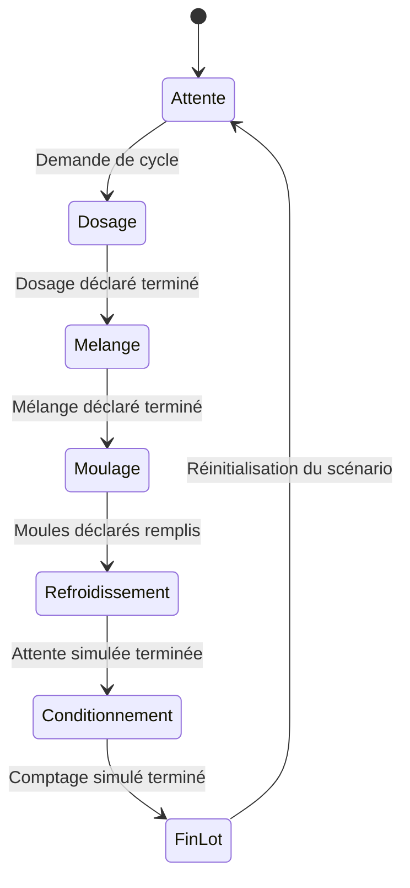

# Automatisation

## Principe

L'automatisation consiste à enchaîner les opérations dans un ordre défini, en vérifiant les conditions nécessaires au passage d'une étape à l'autre.

Dans une installation réelle, les sécurités, arrêts d'urgence, protections et validations doivent être conçus et vérifiés par des personnes compétentes. Le scénario ci-dessous reste une représentation logique fictive, sans commande de matériel.

## Séquence fonctionnelle simplifiée

## Tableau des états

| État | Description | Condition de transition |
|---|---|---|
| Attente | La ligne attend une demande | Demande de cycle |
| Dosage | Le scénario représente le dosage | Dosage terminé |
| Mélange | Le scénario représente l'agitation | Mélange terminé |
| Moulage | Le scénario représente le remplissage | Moulage terminé |
| Refroidissement | Une attente est simulée | Temporisation terminée |
| Conditionnement | Le scénario représente le comptage | Lot terminé |
| Fin de lot | Le cycle est achevé | Réinitialisation |

## Exemple de variables de simulation

| Variable | Type logique | Rôle |
|---|---|---|
| `cycle_demande` | Booléen | Demande de lancement du scénario |
| `niveau_ok` | Booléen | Niveau fictif déclaré suffisant |
| `presence_moule` | Booléen | Moule détecté dans le scénario |
| `etape_active` | Entier / énumération | Étape actuellement représentée |
| `lot_termine` | Booléen | Fin du lot fictif |

## Pistes d'évolution

1. Définir précisément les entrées et sorties du modèle.
2. Construire un Grafcet pédagogique.
3. Associer chaque état à une animation de la maquette virtuelle.
4. Définir des scénarios de test : cycle normal, absence de moule, niveau insuffisant.
5. Documenter les résultats et les limites.

{: .note }
> Les noms et variables sont des exemples de documentation. Ils ne constituent pas un programme d'automate prêt à être chargé sur une installation.
