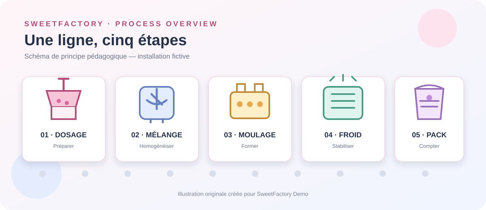
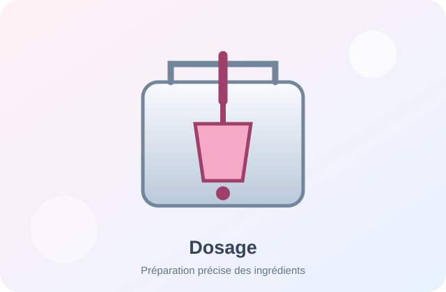
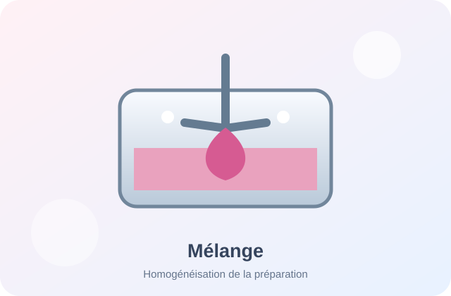
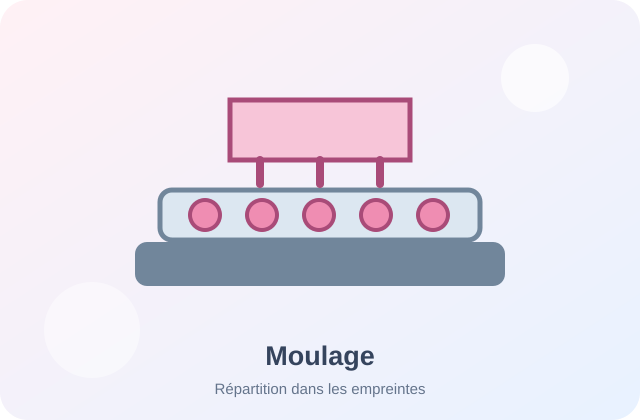
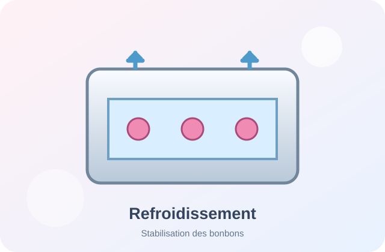
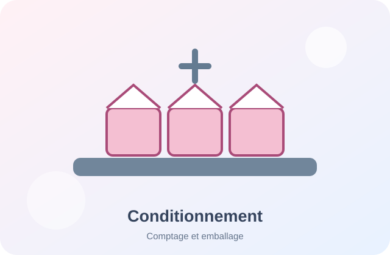

# choholat

## De l'idée au bonbon : comprendre une ligne de production automatisée

Choholat est un projet pédagogique fictif qui présente le fonctionnement d'une petite usine de bonbons gélifiés. Il sert de support pour découvrir les procédés industriels, les équipements, les capteurs, les actionneurs et les bases de l'automatisation.

  **DOSER · MÉLANGER · MOULER · REFROIDIR · CONDITIONNER**

[Découvrir le procédé](procede){: .btn .btn-primary .fs-5 .mb-4 .mb-md-0 .mr-2 }
[Voir les équipements](equipements){: .btn .fs-5 .mb-4 .mb-md-0 }

---

## Le projet en bref

| Repère | Description |
|:--|:--|
| **Type** | Mini-ligne industrielle fictive |
| **Produit** | Bonbons gélifiés |
| **Procédé** | Préparation, transformation et conditionnement |
| **Approche** | Comprendre le système avant de l'automatiser |
| **Finalité** | Apprentissage de la documentation technique et de GitHub |

## Les cinq étapes de fabrication

Passe la souris sur une illustration pour la voir s'agrandir. Tu peux aussi sélectionner une carte au clavier.

  <a class="image-card" href="procede#dosage" aria-label="Découvrir le dosage">
    
    1. Dosage
  </a>
  <a class="image-card" href="procede#melange" aria-label="Découvrir le mélange">
    
    2. Mélange
  </a>
  <a class="image-card" href="procede#moulage" aria-label="Découvrir le moulage">
    
    3. Moulage
  </a>
  <a class="image-card" href="procede#refroidissement" aria-label="Découvrir le refroidissement">
    
    4. Refroidissement
  </a>
  <a class="image-card" href="procede#conditionnement" aria-label="Découvrir le conditionnement">
    
    5. Conditionnement
  </a>

1. **Dosage** — préparer les ingrédients selon une recette fictive.
2. **Mélange** — obtenir une préparation homogène.
3. **Moulage** — répartir la préparation dans des moules.
4. **Refroidissement** — laisser la forme se stabiliser.
5. **Conditionnement** — compter et emballer les bonbons.

## Explorer la documentation

- [Le procédé de fabrication](procede) — comprendre le cheminement du produit.
- [Les équipements](equipements) — identifier les machines, capteurs et actionneurs.
- [L'automatisation](automatisation) — découvrir une séquence de commande pédagogique.
- [Le journal de bord](journal) — suivre les évolutions et les décisions.

## Comment lire ce projet ?

La documentation distingue volontairement le **procédé** (ce que fait l'usine), les **équipements** (avec quoi elle le fait) et l'**automatisation** (comment elle est pilotée). Cette séparation aide à raisonner clairement avant de concevoir une solution technique.

{: .note }
> **Projet fictif :** SweetFactory n'est pas une installation réelle. Les équipements, les paramètres et les séquences présentés sont des exemples destinés à l'apprentissage. Ils ne constituent pas des consignes de fabrication alimentaire.
