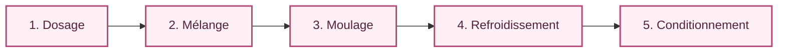

# Procédé de fabrication

## Vue d'ensemble

Le procédé décrit le parcours du produit à travers la ligne. Chaque poste reçoit une matière ou un produit intermédiaire, réalise une opération, puis transmet le résultat au poste suivant.

## 1 — Dosage

**Objectif :** réunir les ingrédients nécessaires à une préparation fictive.

- **Entrée :** ingrédients représentés dans le modèle.
- **Opération :** mesure et transfert vers la cuve.
- **Sortie :** ingrédients prêts à être mélangés.
- **Points à observer :** disponibilité des ingrédients et niveau de la cuve.

## 2 — Mélange

**Objectif :** homogénéiser la préparation dans une cuve.

- **Entrée :** ingrédients dosés.
- **Opération :** agitation représentée par un moteur.
- **Sortie :** préparation homogène (état logique dans la simulation).
- **Points à observer :** état du moteur, durée de cycle et disponibilité de la cuve.

## 3 — Moulage

**Objectif :** répartir la préparation dans des empreintes.

- **Entrée :** préparation disponible.
- **Opération :** transfert vers un poste de remplissage.
- **Sortie :** moules remplis.
- **Points à observer :** présence du moule et position du poste.

## 4 — Refroidissement

**Objectif :** représenter le temps d'attente nécessaire à la stabilisation du produit.

- **Entrée :** moules remplis.
- **Opération :** attente simulée dans une zone dédiée.
- **Sortie :** produits déclarés prêts pour le conditionnement.
- **Points à observer :** présence du plateau et fin du temps simulé.

## 5 — Conditionnement

**Objectif :** compter les produits et représenter leur mise en sachet.

- **Entrée :** produits prêts.
- **Opération :** comptage puis validation d'un lot.
- **Sortie :** lot conditionné dans la simulation.
- **Points à observer :** compteur, présence du sachet et fin de lot.

## Bilan des flux

| Étape | Flux entrant | Flux sortant |
|---|---|---|
| Dosage | Ingrédients | Ingrédients dosés |
| Mélange | Ingrédients dosés | Préparation homogène |
| Moulage | Préparation | Moules remplis |
| Refroidissement | Moules remplis | Produits stabilisés |
| Conditionnement | Produits stabilisés | Lot conditionné |

{: .note }
> Les durées, quantités et paramètres de recette ne sont pas définis à ce stade. Ils seraient à établir dans un véritable projet à partir d'un cahier des charges et de données validées.
